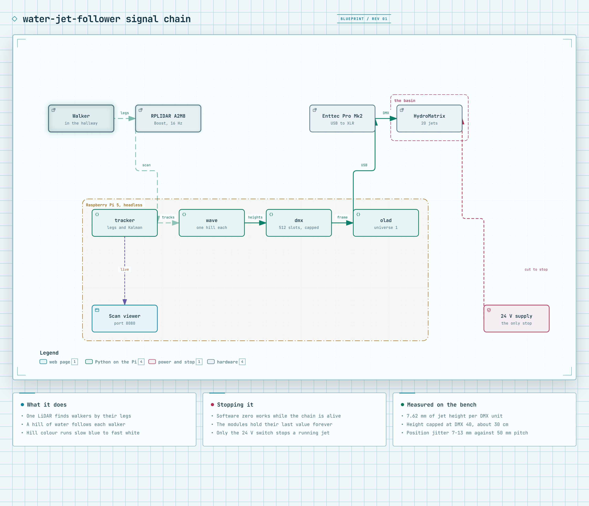

# water-jet-follower

A strip of water jets that follows people along a hallway. One LiDAR finds walkers by their
legs. A hill of water rises under each walker. The control app runs on a Raspberry Pi 5 in
plain Python.

**Prototype. The final build uses all 20 jets. Jets 0 through 9 use a measured person-to-jet
path and are verified with light and water. Jets 10 through 19 are not calibrated yet. The
offline Pi boot and iPad page are proved. The full rig safety checks are not complete.**

[Decisions](DECISIONS.md) · [Next steps](NEXT_STEPS.md) · [Glossary](CONTEXT.md) · [Tracker notes](tracker/README.md)



## How it works

1. The LiDAR sweeps a level slice at shin height.
2. The tracker removes the fixed room points.
3. The tracker clusters moving points and follows each walker.
4. The wave makes one five-jet hill for each confirmed walker.
5. OLA sends a full DMX frame through the Enttec interface.
6. Each nozzle uses red, green, blue, white, and height channels.

The light colour changes with walking speed. A stopped walker keeps a hill while the tracker
still holds that person.

NetworkManager owns the private Pi Wi-Fi. The `water-jet-show.service` systemd service owns
the show process. The web page and show start at boot. Every service start includes
`--lights-only`, so all fountain-height channels start at zero.

If the show process fails, systemd waits five seconds and starts it again. It allows five
starts in five minutes. It then leaves the service failed until a person fixes the cause and
resets it. The private Wi-Fi stays up while the show is stopped.

## Features

- A water hill follows each walker.
- A hill stays with a walker who stops.
- Two walkers can have separate hills.
- Light colour changes from blue to white with speed.
- The settings, test, and system pages work on an iPad.
- The Pi serves its own private Wi-Fi without a site network.
- The system page shows Pi and show state.
- The system page can request a safe reboot or shutdown.

The attract mode is off by default. Keep it off until the hardware watchdog and contactor pass
their real fault tests.

## Hardware

| Part | Choice |
|---|---|
| Sensor | Slamtec RPLIDAR A2M8, one unit, Boost mode |
| Controller | Raspberry Pi 5, Raspberry Pi OS Lite 64-bit, Debian 13 Trixie |
| DMX interface | Enttec DMX USB Pro Mk2 |
| Water | 2 x HB-Laser 3D HydroMatrix HD modules, 10 jets each; first module verified |
| USB hub | Powered hub, Genesys Logic USB2.1/3.1 |
| Module supply | 24 V DC, 3.2 A per module |

The powered hub is required. The LiDAR reset when its motor started from a Pi USB port.

Boost mode is required. The lower sample modes do not give enough position detail at the set
scan rate.

The modules hold their last height when DMX stops. A software stop cannot clear a held value
after OLA, the Enttec, the Pi, or module communication fails. The physical switch on the 24 V
module supply is the only proved stop for those faults.

The watchdog and contactor are a design only. They are not built or proved. See
[the watchdog design](hardware/watchdog-contactor.md) and [its BOM](hardware/bom.md).

## Wiring

| From | To | Cable | Notes |
|---|---|---|---|
| RPLIDAR A2M8 | Powered USB hub | USB | The udev rule makes `/dev/ttyLIDAR` from its USB vendor and product IDs. |
| Enttec Pro Mk2 | Powered USB hub | USB | The serial-matched udev rule makes `/dev/ttyENTTEC`. Its serial is `EN329670`. |
| Powered USB hub | Raspberry Pi 5 | USB | The hub uses its own power supply. |
| Enttec breakout | Module 1 input | 5-pin XLR | The Enttec output is female. The module input is male. |
| Module 1 | Module 2 | HB-Laser link | The final build uses both modules. The checked bench setup uses module 1 only. |
| 24 V supply | Module 1 | HB-Laser feed | Keep the physical power switch in reach. |

## Pi setup

There is no `SETUP.md` in this repo. The Pi now has the install files and the checked runtime
state below.

| Item | Installed choice |
|---|---|
| Python | System Python 3.13.5 and `/home/pi/wj-venv` |
| `pyrplidar` | 0.1.2 |
| OLA | `ola` and `ola-python` 0.10.9 from apt |
| Wi-Fi profile | NetworkManager profile `water-jets-ap` |
| Private Wi-Fi | SSID `water-jets`, fixed Pi address `10.42.0.1/24` |
| Show service | `water-jet-show.service`, enabled at boot |
| Show command | `tracker.run show` with fixed data paths and `--lights-only` |
| Failure recovery | Restart after 5 seconds, with a limit of five starts in five minutes |
| OLA lock cleanup | Root systemd service before OLA starts |
| Logs | systemd journal |

The OLA cleanup service checks matching lock files before it removes a stale lock. Do not
delete `/var/lock/LCK..ttyUSB*` by hand.

Read these files before a new install or repair:

- [Current Pi state before this install](docs/pi-install/current-state-2026-09-25.md)
- [Service and recovery design](docs/pi-install/service-and-recovery-design.md)
- [Operator access and rescue](docs/pi-install/operator-access-and-rescue.md)
- [Install build record](docs/pi-install/build-record-2026-09-25.md)
- [Real Pi boot and recovery proof](docs/pi-install/real-pi-proof-2026-09-25.md)

## Quickstart

Keep the 24 V module power off until the live-water safety check starts.

1. Join the `water-jets` Wi-Fi on the iPad.
2. Get the password from the private local record.
3. Open `http://10.42.0.1:8080/`.
4. Check that **Lights only** is on.

The private password record is outside this repo. Do not copy it into Git, an issue, or a log.

The fixed URL is the main operator address. The offline iPad test passed with no Ethernet and
no site network. Do not depend on the optional `.local` name until it passes a separate offline
test.

## Operator recovery

Use wired Ethernet for network rescue when a known LAN is present. The address
`10.0.10.204` was checked on the current LAN. It can change on another LAN.

Use a micro-HDMI display and a USB keyboard when no network path works.

Private Wi-Fi SSH has not passed its real client test. Use the checked wired address on the
current LAN for rescue from Windows PowerShell:

```powershell
ssh pi@10.0.10.204
```

Then run these read-only commands in the Pi Bash shell:

```bash
systemctl status water-jet-show.service olad.service water-jet-ola-lock-cleanup.service NetworkManager.service --no-pager --lines=20
systemctl show water-jet-show.service -p ActiveState -p SubState -p Result -p NRestarts -p ExecMainStatus
journalctl -b -u water-jet-show.service -u olad.service -u water-jet-ola-lock-cleanup.service --no-pager -n 200
nmcli -f DEVICE,TYPE,STATE,CONNECTION device status
ip -4 -br addr
```

Keep the 24 V module power off when the output state is not known. Fix the cause before you
reset a failed start limit. See the [operator access and rescue guide](docs/pi-install/operator-access-and-rescue.md)
for the full checks and the [service design](docs/pi-install/service-and-recovery-design.md)
for recovery rules.

## Development workflow

The installed service is the normal operator path. Stop it before you start a second show by
hand. Use the tracker guide for a manual Pi run.

List the development commands from Windows PowerShell:

```powershell
python -m tracker.run --help
```

Run the tests from Windows PowerShell:

```powershell
python -m pytest tracker/tests -q
```

The tests use fake scans and temporary files. They do not prove the real hardware state.

The tracker command also supports recording, baseline creation, replay, DMX checks, manual
jogging, zero output, and the live show. See [tracker/README.md](tracker/README.md) for those
development and bench commands.

## Project structure

| Path | Holds |
|---|---|
| `tracker/` | Tracker, wave, DMX, web pages, system status, and tests |
| `tracker/run.py` | Command line entry point |
| `deploy/pi/` | Pi install script and checked OLA lock cleanup code |
| `deploy/systemd/` | Show, cleanup, and OLA systemd files |
| `data/` | Recorded scans, baselines, and local run data |
| `hardware/` | Hardware stop design and BOM |
| `docs/pi-install/` | Pi state, access, install, and proof records |
| `docs/` | Build notes, diagrams, and agent guides |

## Safety and proof limits

The Pi passed the show crash, restart, five-start limit, manual recovery, private Wi-Fi restart,
normal reboot, and isolated iPad page checks. Each checked service start used Lights only.

These checks do not prove physical water off. They also do not prove the full rig cold boot,
private Wi-Fi SSH, offline `.local` name, LiDAR reconnect, local-console rescue, rollback, or
password rotation. Do not call the full rig install-ready until the open physical checks pass.

## Documentation

- [DECISIONS.md](DECISIONS.md) records locked choices and their reasons.
- [NEXT_STEPS.md](NEXT_STEPS.md) records the wider project state.
- [CONTEXT.md](CONTEXT.md) defines the project words.
- [docs/BUILD_SPEC.md](docs/BUILD_SPEC.md) gives the 20-jet build specification.
- [tracker/README.md](tracker/README.md) gives tracker and bench details.
- [docs/water-jet-follower.html](docs/water-jet-follower.html) shows the interactive signal chain.

<!-- create-readme v0.2.4 -->
